# AWS production and staging assessment — deferred research

Research date: 21 November 2026. **Deployment is on hold.** Prior accepted choices are preserved in [deferred deployment decisions](decisions.md); the active phase is [local application implementation](../technical/decisions.md). The assessment below is retained research, not current implementation prerequisites. T31 replaced RDS with Lightsail/self-managed PostgreSQL; Fargate was not accepted. See [aws-cost-research.md](aws-cost-research.md) for historical alternatives and cost research.

## Previously accepted launch direction — T31, parked

Use one **AWS Lightsail Linux VM, 2 GB RAM with public IPv4 ($12/month advertised bundle)** for the initial small deployment. Run Next.js, Mastra, and PostgreSQL/pgvector as separate containers/processes on that host, with an HTTPS reverse proxy. Build release images in CI, not on the small VM. The bundle includes disk and transfer allowance; capacity must be measured before promising throughput. No GPU is needed when media/models are external APIs. [Lightsail pricing](https://aws.amazon.com/lightsail/pricing/)

This recommendation explicitly changes the earlier managed-RDS direction: database maintenance, patching, backups, restore procedures, and host recovery become our responsibilities. A single host is one failure boundary for both application and database, with no automatic HA failover. Require off-host database backups and tested restore before admitting real user data; revisit recovery-point requirements if managed point-in-time recovery is dropped.

Retain Terraform, GitHub Actions/OIDC, separate staging/production accounts, S3/CloudFront media, and the accepted Mastra+Inngest Free integration within its limits. Avoid adding paid observability subscriptions; configure bounded logs and basic host/application alerts. No ECS/Fargate, ALB, NAT gateway, Redis, separate vector service, paid Inngest plan, or dedicated always-running generation host is needed for this launch profile.

For staging, provision a separate VM from Terraform when testing/releasing, deploy the same release images, and use a separate PostgreSQL container with seeded test data. Destroy the disposable compute after checks; never share production volumes or credentials. Ordinary Lightsail VMs still bill when stopped, so stopping alone is not the intended savings mechanism. Bound staging lifetime and release unneeded static IPs as well. [Lightsail billing FAQ](https://aws.amazon.com/lightsail/faq/)

Planning allocation at the **$25 end** of the user's range:

| Budget bucket | Monthly allocation | Meaning |
| --- | --- | --- |
| Production VM | $12 | Advertised 2 GB Linux/IPv4 bundle; confirm Frankfurt availability and invoice terms before provisioning |
| Disposable staging, backups, storage/delivery, registry/logs | $3 | Planning allowance, not a measured bill; bound retained data, staging hours, and requests |
| Search, text models, images, narration | $5 | Total paid-creation allowance; no story count promised until measured |
| Reserve | $5 | Taxes/fees and uncertainty; domain purchase cost still needs accounting if required |
| Total | $25 | Budget allocation, not proof of fit or permission to spend |

Do not promise this at $10/month. If the actual operational minimum, memory needs, or tax/domain costs exhaust the reserve, stop and revise the configuration before deployment. Gate paid creation by budget and concurrency, not by an assumed unlimited free tier. This profile supports a small pilot; actual story quality/creation volume still depends on model costs and measured complete runs.

## Earlier deployment requirements — deferred

Treat this as a production product from the start: a real staging environment, CI/CD, infrastructure as code, security boundaries, recoverable data, and observable operation. The initial $10–25/month total budget is a constraint to evaluate, not permission to omit these requirements or a verified price for two hosted environments.

Railway was rejected. RDS replaced Neon in T24 and was itself replaced by the Lightsail/self-managed PostgreSQL choice in T31. S3/CloudFront replaced R2 in T29. These deployment choices are now parked. PostgreSQL/Drizzle and Mastra+Inngest remain part of active application design. Consult the deferred decision record rather than treating earlier alternatives below as requirements.

## Earlier managed-database baseline — now under affordability review

The earlier baseline used RDS PostgreSQL with separate staging/production instances. T30 reopens that choice for affordability. This section preserves the historical managed-database assessment; it does not override the parked topology in the deployment decision record or authorize a replacement database host.

Database vendor choice alone does not establish production readiness. Specify access controls, backups, restore evidence, deployment procedures, migrations, and service objectives for whichever host is chosen. RDS supports automated backups and point-in-time recovery within its configured retention window; recovery must still be exercised. [RDS backups](https://docs.aws.amazon.com/AmazonRDS/latest/UserGuide/USER_WorkingWithAutomatedBackups.html)

## Deployment alternatives to cost as complete systems

| Candidate | Product fit | Cost/engineering consequence |
| --- | --- | --- |
| ECS/Fargate containers for Next.js and Mastra, private RDS | Ordinary Node services; straightforward container boundaries and long-running workers | Compute, load balancing, networking, and database contribute recurring costs; assess the complete topology before choosing it |
| AWS serverless Next.js deployment, bounded generation tasks, private managed PostgreSQL | Low-idle compute; requires a compatible Next.js adapter and explicit task boundaries | Check adapter compatibility, cold starts, database connections, task limits, and internet egress from private networks; less idle compute does not remove other costs |

Mastra supports Node-compatible environments and independent server deployment. ECS Express Mode provisions Fargate, load balancing, monitoring, and networking; it does not make those underlying resources free. OpenNext documents an AWS deployment adapter, but its compatibility with the chosen Next.js version/features needs verification before selection. [Mastra deployment](https://mastra.ai/docs/deployment/overview), [ECS Express Mode](https://docs.aws.amazon.com/AmazonECS/latest/developerguide/express-service-overview.html), [OpenNext AWS](https://opennext.js.org/aws)

Keep one workflow owner. Mastra+Inngest remains the accepted application choice; deployment deferral does not reopen it. The earlier AWS-native Step Functions comparison is historical, not a pending framework decision. [Mastra workflow runners](https://mastra.ai/docs/deployment/workflow-runners), [AWS Step Functions](https://docs.aws.amazon.com/step-functions/latest/dg/welcome.html)

## Environments

Proposed environment contract:

- **Local:** reproducible setup, PostgreSQL/pgvector and deterministic fixtures; paid models only through explicit development configuration.
- **Staging:** deployed URL, independent database/data, storage, credentials, authentication callback URLs, workflow namespace, and usage limits. Exercise the production topology using smaller capacity and safe test data. Test billing mode; prevent public indexing and unauthorized access.
- **Production:** production identities/data only, restricted deployment permissions, backup retention, monitoring, and independent spending controls.

Prefer separate AWS accounts for staging and production with the same reusable infrastructure definitions and separate state. This is a proposed isolation boundary, not a requirement to adopt a large organizational hierarchy. AWS documents separation of production and nonproduction workloads; an appropriate small account structure can be expanded later. [AWS account organization](https://docs.aws.amazon.com/whitepapers/latest/organizing-your-aws-environment/recommended-ous-and-accounts.html)

Staging may run on a schedule or on demand if explicitly chosen for budget reasons. It must remain independently deployable and must not use production data or credentials. Match relevant engine/configuration versions even if instance sizes differ. Record differences, especially availability and capacity; a staging pass is not proof of production load capacity.

## Proposed CI/CD contract

1. **Pull request:** formatting/lint, TypeScript checks, focused tests, schema contracts, PostgreSQL migration checks, secret/dependency checks, and deterministic generation-workflow fixtures. Use a separately budgeted live AI evaluation path rather than unrestricted paid calls on every commit.
2. **Build once:** produce a release identified by commit and immutable artifact/image digest. Publish container artifacts to ECR if the container option is selected. Record model, prompt, and content-schema versions with the release.
3. **Deploy staging:** apply reviewed infrastructure changes using a staging-only role, apply compatible migrations through one controlled runner, deploy the release, and run real browser/API/database/media smoke paths. Check recovery of interrupted workflow tasks and persistence of a saved position.
4. **Promote:** select the exact staged artifact for production, with explicit release authorization. Avoid rebuilding application code between environments. Keep environment-specific configuration out of build artifacts where possible; explicitly account for any Next.js values baked into browser bundles.
5. **Observe and recover:** verify health and critical user paths, watch errors and latency, and retain the prior artifact for application rollback. Schema changes need expand/contract compatibility; rolling back code does not undo destructive data changes.

Use GitHub Actions OIDC with narrowly scoped, environment-specific AWS roles rather than permanent AWS access keys. Restrict the trust policy to the actual repository and release context. GitHub deployment environments can protect secrets and releases, but required-reviewer availability depends on repository visibility and plan; confirm before relying on that gate. [GitHub AWS OIDC](https://docs.github.com/en/actions/how-tos/secure-your-work/security-harden-deployments/oidc-in-aws), [deployment environments](https://docs.github.com/en/actions/how-tos/deploy/configure-and-manage-deployments/manage-environments)

```mermaid
flowchart LR
    PR[Pull request] --> Checks[CI and deterministic checks]
    Checks --> Build[Build immutable release]
    Build --> Stage[Deploy isolated staging]
    Stage --> Validate[Migration and real user-flow checks]
    Validate --> Release[Explicit production release]
    Release --> Prod[Promote same artifact to production]
    Prod --> Observe[Health and operational monitoring]
    Observe --> Recover[Rollback artifact or follow data recovery plan]
```

## Infrastructure and operations

Propose Terraform modules reused by environment, with separate state, encrypted/versioned S3 state storage, locking, least-privilege deployment roles, and reviewable plans. Use the current S3 lockfile feature where compatible; the course/Obsidian pattern of a new DynamoDB lock table is no longer the default recommendation because that locking mechanism is deprecated. [Terraform S3 backend](https://developer.hashicorp.com/terraform/language/backend/s3)

Production readiness should include:

- Private database networking with restricted application/migration access; explicit design for third-party model/search API egress. Do not make the database public simply to conceal networking costs. [RDS VPC guidance](https://docs.aws.amazon.com/AmazonRDS/latest/UserGuide/USER_VPC.WorkingWithRDSInstanceinaVPC.html)
- Secrets/configuration separated by environment, scoped runtime identities, tenant authorization, and verified workflow callback signatures.
- Structured logs/metrics/traces with retention and privacy rules; alerts for failed/stuck jobs, error rates, latency, database capacity, and usage.
- Durable workflow recovery, bounded retries/concurrency, deduplicated submissions, provider job reconciliation, and budget reservations before costly work.
- Defined backup retention, restore rehearsal, artifact recovery, asset lifecycle/deletion rules, and response steps for provider outages.
- Explicit recovery-time/recovery-point and availability objectives before choosing Single-AZ versus Multi-AZ capacity. Neither option is selected yet.

These are proposed release criteria, not claims that any configuration or verification currently exists. The repository currently contains documentation and visual references, with no application, Git repository, CI jobs, infrastructure, or deployment.

## Applying the Ed Donner course

The local course under `/Users/maximus/Projects/Ed Donner AI in production/` is useful for Docker/ECR/IAM/logging (`week1/day5.md`), Lambda/API Gateway/S3/CloudFront (`week2/day2.md`), Terraform (`week2/day4.md`), OIDC/GitHub deployment (`week2/day5.md`), and AgentCore (`finale/README.md`). Weeks 3–4 link to separate `cyber`/`alex` repositories, which were not found as top-level local projects in this pass; those materials have not been inspected.

Apply patterns with current documentation rather than copying every configuration:

- App Runner is now closed to new customers; it cannot be assumed available for a fresh deployment. The earlier chat presented it as a candidate without this qualification. [AWS availability change](https://docs.aws.amazon.com/apprunner/latest/dg/apprunner-availability-change.html)
- A static Next.js export does not preserve all runtime features needed by our agreed server-rendered application. Evaluate a full Node runtime or compatible AWS adapter.
- Replace broad example IAM grants with resource-scoped application/deployment roles.
- Treat budget notifications as delayed alerts, not an instantaneous universal cap. [AWS Budgets](https://docs.aws.amazon.com/cost-management/latest/userguide/budgets-managing-costs.html)
